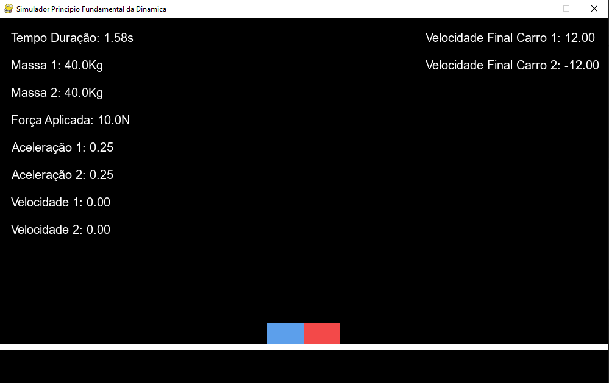

# Physics Simulator: Newton's Second Law ($F = m \cdot a$)

This project is an extra assignment developed for the **Experimental Physics 1** course. It is an interactive physics simulation built in Python using Pygame to visualize and analyze Newton's Second Law and motion dynamics using a two-cart system connected by an elastic element.

## Preview

<p align="center">
  
</p>

## Controls

| Key Combination | Action |
| :--- | :--- |
| **Left Arrow** (`←`) | Decrease applied force |
| **Right Arrow** (`→`) | Increase applied force |
| **Up Arrow** (`↑`) | Increase Car 1 mass |
| **Down Arrow** (`↓`) | Decrease Car 1 mass |
| **Shift + Up Arrow** (`Shift + ↑`) | Increase Car 2 mass |
| **Shift + Down Arrow** (`Shift + ↓`) | Decrease Car 2 mass |
| **Spacebar** | Start / Reset simulation |

## Requirements
* Python 3.12
* Pygame

## How to Run
```bash
python main.py