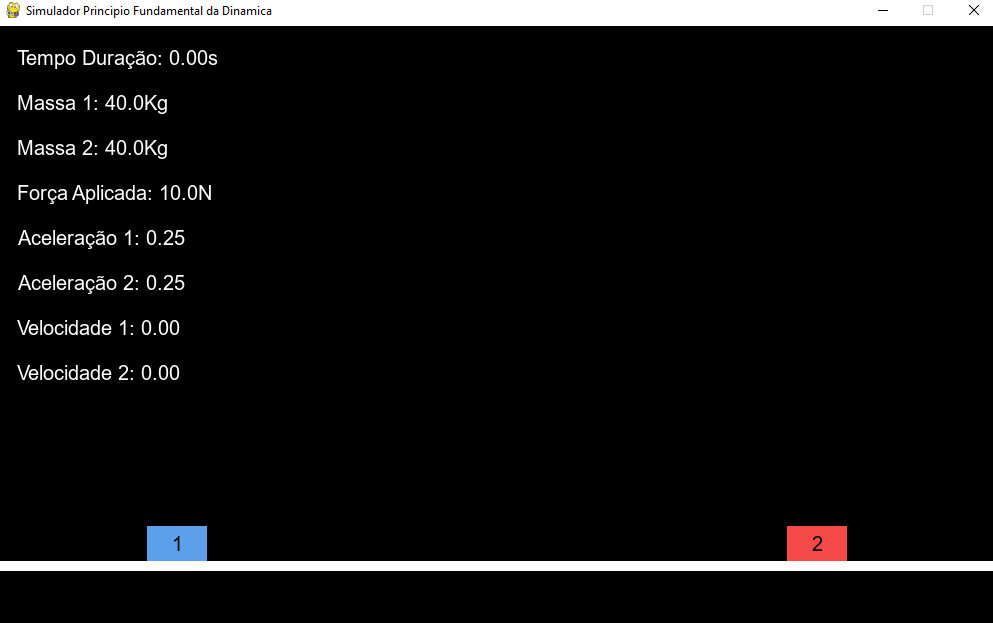

# Physics Simulator: Newton's Second Law ($F = m \cdot a$)

This project is an extra assignment developed for the **Experimental Physics 1** course. It is an interactive physics simulation built in Python using Pygame to visualize and analyze Newton's Second Law and motion dynamics using a two-cart system connected by an elastic element.

## ✨ Key Features
* **Real-Time Delta Time (`dt`) Integration:** Replaces rigid frame-by-frame steps with precise time-step calculations (`clock.tick(60) / 1000`), ensuring hardware-independent execution and introducing realistic experimental micro-variations (noise) for lab reporting.
* **Live Distance Tracking:** Dynamically calculates, tracks, and displays the real-time distance between the two carts (`distância entre carrinhos`) throughout the run until collision.
* **Interactive Parameters & Automated Plotting:** Allows real-time adjustments of applied forces and individual cart masses, featuring instant Matplotlib graph generation ($v \times t$) for comprehensive engineering analysis.

## Preview

<p align="center">
  
</p>

## Controls

| Key Combination | Action |
| :--- | :--- |
| **Left Arrow** (`←`) | Decrease applied force |
| **Right Arrow** (`→`) | Increase applied force |
| **Up Arrow** (`↑`) | Increase Car 1 mass |
| **Down Arrow** (`↓`) | Decrease Car 1 mass |
| **Shift + Up Arrow** (`Shift + ↑`) | Increase Car 2 mass |
| **Shift + Down Arrow** (`Shift + ↓`) | Decrease Car 2 mass |
| **Spacebar** (`Space`) | Start / Pause simulation |
| **Enter** (`↵`) | Reset simulation |
| **G** (`g`) | Generate / Display Matplotlib graph (after experiment) |

## Requirements
* Python 3.12
* Pygame
* Matplotlib

## How to Run
```bash
python main.py